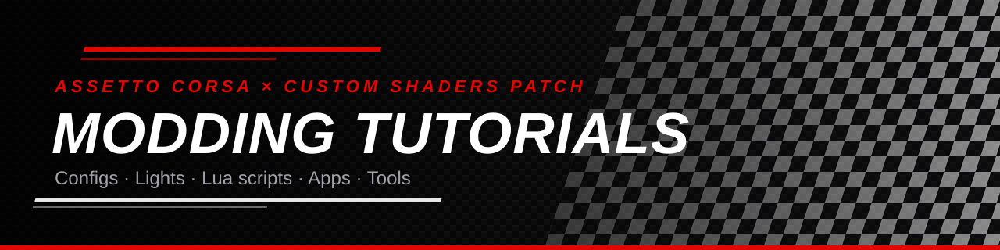
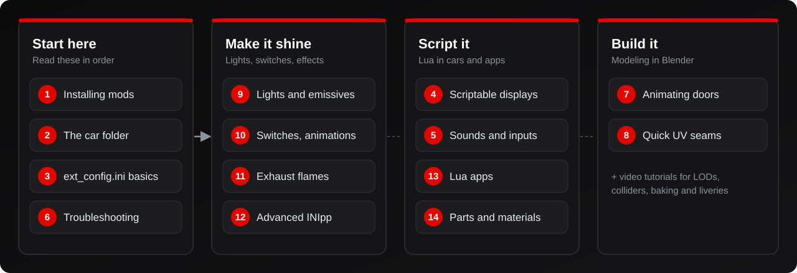

  

  
  
  
  
  

  <b>Practical guides for modding Assetto Corsa with Custom Shaders Patch.</b> 
  From installing your first mod to writing Lua apps, with small examples you can copy straight into your car.

---

## Where to start

  

New to modding? Read the green column first. After that, pick the track that matches what you want to build.

## Tutorials

### Basics

| | Tutorial | What you learn |
|:-:|---|---|
|  | [**1. Installing mods**](tutorials/01-installing-mods.md) | Content Manager, CSP, where cars and tracks go, fixing broken installs |
|  | [**2. The car folder**](tutorials/02-car-folder.md) | What `data`, `extension`, `skins`, `sfx` and `ui` are for |
|  | [**3. ext_config.ini basics**](tutorials/03-ext-config-basics.md) | Sections, includes, emissives, shader replacements, finding mesh names |
|  | [**6. Troubleshooting**](tutorials/06-troubleshooting.md) | Black screens, scripts that do nothing, where the logs are |

### Lights, switches and effects

| | Tutorial | What you learn |
|:-:|---|---|
|  | [**9. Lights and emissives**](tutorials/09-lights-and-emissives.md) | Every emissive type, fallback colors, sequential turn signals, dynamic lights, line lights |
|  | [**10. Switches and animations**](tutorials/10-switches-and-animations.md) | Extra A to F, `ANIMATION_` sections, all inputs, wobbly bits |
|  | [**11. Exhaust flames**](tutorials/11-exhaust-flames.md) | Antilag, flat shift, discharge, limiter and damage flames |
|  | [**12. Advanced configs with INIpp**](tutorials/12-inipp.md) | Variables, expressions, templates, optional sections |

### Lua scripting

| | Tutorial | What you learn |
|:-:|---|---|
|  | [**4. Scriptable displays**](tutorials/04-scriptable-displays.md) | Draw a working speed/gear/RPM screen on any mesh |
|  | [**5. Sounds and inputs**](tutorials/05-sounds-and-inputs.md) | Play sounds, react to Extra buttons and camera view |
|  | [**13. Lua apps**](tutorials/13-lua-apps.md) | `manifest.ini`, windows, immediate mode UI, callbacks |
|  | [**14. Moving parts and materials**](tutorials/14-lua-scene-objects.md) | Needles, indicators, scrolling textures, clickable meshes, physics events, CSP's Lua rules |

### Modeling in Blender

| | Tutorial | What you learn |
|:-:|---|---|
|  | [**7. Animating doors**](tutorials/07-animating-doors.md) | `BODY_HR` / `COCKPIT_HR` / `STEER_HR`, keyframes, ksanim export |
|  | [**8. Quick UV seams**](tutorials/08-uv-seams.md) | Boundary loop seams for body panels, tips for liveries |

## Examples

<table>
<tr>
<td width="33%" valign="top">

### [Digital cluster](examples/scriptable-display)
Speed, gear, RPM bar, shift light and fuel gauge on a scriptable display.

`extension/` · Lua

</td>
<td width="33%" valign="top">

### [Seatbelt chime](examples/seatbelt-chime)
A warning sound that only plays in the cockpit view.

`extension/` · Lua

</td>
<td width="33%" valign="top">

### [Top Speed app](examples/lua-app-top-speed)
Lua app with a window, settings and saved preferences.

`apps/lua/` · Lua

</td>
</tr>
</table>

## Reference

| | |
|---|---|
| [**CSP PBR materials**](reference/csp-pbr-materials.ini) | Every carpaint, interior and glass template with defaults and an explanation of each value |
| [**CSP projects on GitHub**](resources/csp-github.md) | All 18 repositories of the CSP organization, sorted by what you use them for |
| [**Video tutorials and tools**](resources/video-tutorials.md) | YouTube tutorials for LODs, colliders, flames, Blender, baking, UVs and liveries |

## Resources

<b>Tools</b>

- [Content Manager](https://assettocorsa.club/content-manager.html) - the launcher almost everyone uses. Installs mods by drag and drop, has a showroom and the CSP settings.
- [Custom Shaders Patch](https://acstuff.club/patch/) - new shaders, lights, weather and the Lua scripting used here. Installed through Content Manager.
- [Bakery (VAO baker)](https://github.com/ac-custom-shaders-patch/acc-bakeryoptix) - bakes vertex ambient occlusion for cars and tracks.
- [SDK shaders](https://github.com/ac-custom-shaders-patch/sdk-shaders) - CSP shaders for ksEditor.
- Kunos SDK - ships with the game in `assettocorsa/sdk`: ksEditor (`sdk/editor`) and the FMOD audio SDK (`sdk/audio`).

More in [video tutorials and tools](resources/video-tutorials.md#tools).

<b>Documentation</b>

- [CSP config wiki](https://github.com/ac-custom-shaders-patch/acc-extension-config/wiki) - reference for every `ext_config.ini` section.
- [CSP configs](https://github.com/ac-custom-shaders-patch/acc-extension-config) - the configs CSP ships with. Great for seeing how real cars are set up.
- [CSP Lua SDK](https://github.com/ac-custom-shaders-patch/acc-lua-sdk) and its [wiki](https://github.com/ac-custom-shaders-patch/acc-lua-sdk/wiki) - every Lua function, for autocomplete in your editor.
- [CSP Lua examples](https://github.com/ac-custom-shaders-patch/acc-lua-examples) - car, physics, track, online and WeatherFX scripts.

<b>Content and community</b>

- [Assetto Corsa on Steam](https://store.steampowered.com/app/244210/)
- [Official Assetto Corsa forum](https://www.assettocorsa.net/forum/) - includes the modding section with Kunos documentation.
- [Shutoko Revival Project](https://shutokorevivalproject.com/) - the well known Tokyo highway map.
- [Overtake (formerly RaceDepartment)](https://www.overtake.gg/) - large mod database and forum.
- [Peter Boese on Patreon](https://www.patreon.com/peterboese) - author of the Pure weather and lighting mod.

## Contributing

Found a mistake or have a trick worth sharing? Open an issue or a pull request. Please test changes in game first and mention your CSP version.

## License

Code examples are under the [MIT license](LICENSE). The PBR reference and the tutorials based on the CSP wiki summarize documentation from the [Custom Shaders Patch project](https://github.com/ac-custom-shaders-patch).

Assetto Corsa is a trademark of Kunos Simulazioni. This repository is not affiliated with Kunos or the CSP project.
