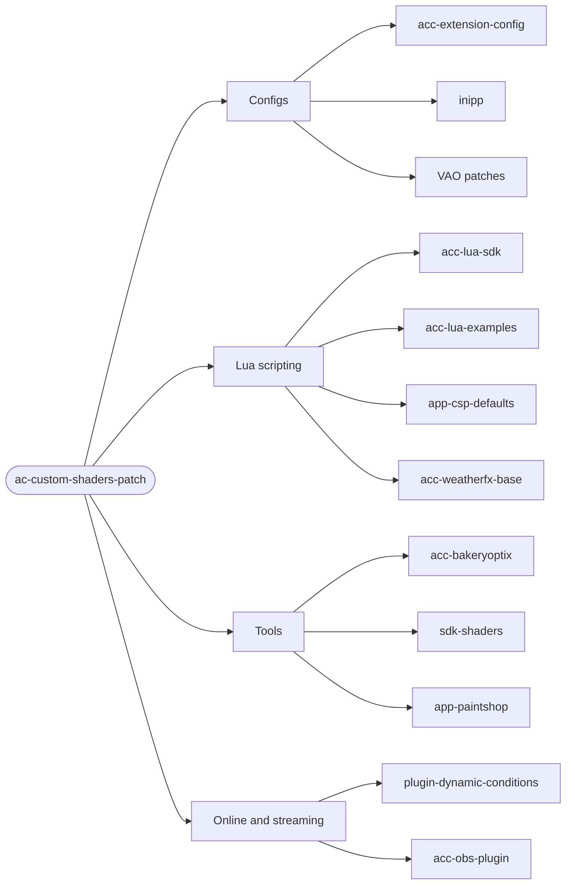

# The CSP projects on GitHub

Custom Shaders Patch publishes its configs, Lua libraries, examples and tools in the [ac-custom-shaders-patch](https://github.com/ac-custom-shaders-patch) organization. This page sorts the repositories by what you would use them for.

## Configs

| Repository | What it is | Use it for |
|---|---|---|
| [acc-extension-config](https://github.com/ac-custom-shaders-patch/acc-extension-config) | All configs CSP ships with, for cars and tracks, plus the shared `common/` files | Look up how a Kunos or popular mod car is configured. The [wiki](https://github.com/ac-custom-shaders-patch/acc-extension-config/wiki) is the main reference for every `ext_config.ini` section |
| [inipp](https://github.com/ac-custom-shaders-patch/inipp) | The INI preprocessor CSP uses | Understand variables, expressions and templates ([tutorial 12](../tutorials/12-inipp.md)), or run it to see what a config expands to |
| [acc-extension-cars-vao](https://github.com/ac-custom-shaders-patch/acc-extension-cars-vao) | Vertex AO patches for cars | Reference only, new patches are not accepted at the moment |
| [acc-extension-extra-vao](https://github.com/ac-custom-shaders-patch/acc-extension-extra-vao) | Additional VAO patches | Reference |

### Useful wiki pages

| Topic | Page |
|---|---|
| Glowing meshes | [Emissive objects](https://github.com/ac-custom-shaders-patch/acc-extension-config/wiki/Cars-%E2%80%93-Emissive-objects) |
| Dynamic lights | [Lights](https://github.com/ac-custom-shaders-patch/acc-extension-config/wiki/Cars-%E2%80%93-Lights) |
| Inputs for everything | [Instruments inputs](https://github.com/ac-custom-shaders-patch/acc-extension-config/wiki/Cars-%E2%80%93-Instruments-inputs) |
| Digital and analog gauges | [Digital instruments](https://github.com/ac-custom-shaders-patch/acc-extension-config/wiki/Cars-%E2%80%93-Digital-instruments), [Analog instruments](https://github.com/ac-custom-shaders-patch/acc-extension-config/wiki/Cars-%E2%80%93-Analog-instruments) |
| Animations | [Animations](https://github.com/ac-custom-shaders-patch/acc-extension-config/wiki/Cars-%E2%80%93-Animations) |
| Physics | [Enabling extended physics](https://github.com/ac-custom-shaders-patch/acc-extension-config/wiki/Cars-%E2%80%93-Enabling-extended-physics), [Physics scripts](https://github.com/ac-custom-shaders-patch/acc-extension-config/wiki/Cars-%E2%80%93-Physics-scripts) |
| Shaders | [Shader replacements](https://github.com/ac-custom-shaders-patch/acc-extension-config/wiki/General-%E2%80%93-Shader-replacements) |
| Tips from the CSP author | [Tips and tricks](https://github.com/ac-custom-shaders-patch/acc-extension-config/wiki/Cars-%E2%80%93-Tips-and-tricks) |

## Lua scripting

| Repository | What it is | Use it for |
|---|---|---|
| [acc-lua-sdk](https://github.com/ac-custom-shaders-patch/acc-lua-sdk) | Definitions and source of the CSP Lua libraries | Autocomplete in your editor ([tutorial 4](../tutorials/04-scriptable-displays.md#4-editor-setup)). The [wiki](https://github.com/ac-custom-shaders-patch/acc-lua-sdk/wiki) has the Lua apps guide and important rules |
| [acc-lua-examples](https://github.com/ac-custom-shaders-patch/acc-lua-examples) | Examples for car, physics, track, online, new mode and WeatherFX scripts | Copy and adapt. Car snippets are covered in [tutorial 14](../tutorials/14-lua-scene-objects.md) |
| [acc-lua-internal](https://github.com/ac-custom-shaders-patch/acc-lua-internal) | Lua internals and built-in scripts | See how CSP itself uses the API |
| [app-csp-defaults](https://github.com/ac-custom-shaders-patch/app-csp-defaults) | The apps from CSP's App Shelf: Radar, Flashlight, Internet Radio, Rally Copilot, Setup Exchange, Time Shift, Web Browser and more | Real, complete Lua apps to learn from ([tutorial 13](../tutorials/13-lua-apps.md)) |
| [acc-weatherfx-base](https://github.com/ac-custom-shaders-patch/acc-weatherfx-base) | The default WeatherFX script, public domain and heavily commented | Starting point for your own weather |

## Tools

| Repository | What it is |
|---|---|
| [acc-bakeryoptix](https://github.com/ac-custom-shaders-patch/acc-bakeryoptix) | Bakes vertex ambient occlusion (VAO) for cars and tracks. CPU (Embree) or GPU (Vulkan) baking. Handles LODs, `COCKPIT_HR`/`COCKPIT_LR`, seatbelts, doors and steering wheel animations, driver shadows. CSP expects VAO to be present, especially on tracks |
| [sdk-shaders](https://github.com/ac-custom-shaders-patch/sdk-shaders) | New CSP shaders compiled for ksEditor and for vanilla AC, so you can use them while building a model. Includes `ksPerPixelMultiMap_emissive` (colored emissive mask) and `stPerPixelMultiMap_specular` |
| [app-paintshop](https://github.com/ac-custom-shaders-patch/app-paintshop) | Paint directly on cars in game: brushes, blur, smudge, mirroring, pen pressure, Photoshop-like hotkeys |
| [ac-grass-gen](https://github.com/ac-custom-shaders-patch/ac-grass-gen) | Small tool to generate grass textures |

> [!TIP]
> **Paintshop workflow:** start from a plain white skin. The app uses the original texture as AO and puts it over your work when you **export**. **Save** keeps your work without AO, so you can open it again later.

## Online and streaming

| Repository | What it is |
|---|---|
| [plugin-dynamic-conditions](https://github.com/ac-custom-shaders-patch/plugin-dynamic-conditions) | acServer plugin for changing weather, time and grip online, matching Content Manager's live conditions. CM can export the config for you |
| [acc-obs-plugin](https://github.com/ac-custom-shaders-patch/acc-obs-plugin) | OBS Studio plugin that gives you AC textures directly: clean view without HUD, virtual mirror, chase or track camera, and textures from Lua apps. Enable *OBS integration* in CSP's Small Tweaks |
| [acc-extension-config-server](https://github.com/ac-custom-shaders-patch/acc-extension-config-server) | Simple server for providing access to configs |
| [acc-cef-layer](https://github.com/ac-custom-shaders-patch/acc-cef-layer) | Background service running CEF (the embedded browser) |

## Older projects

| Repository | Note |
|---|---|
| [acc-extension-apps](https://github.com/ac-custom-shaders-patch/acc-extension-apps) | Python apps for CSP. Lua apps are the modern way |

---

[Index](../README.md)
