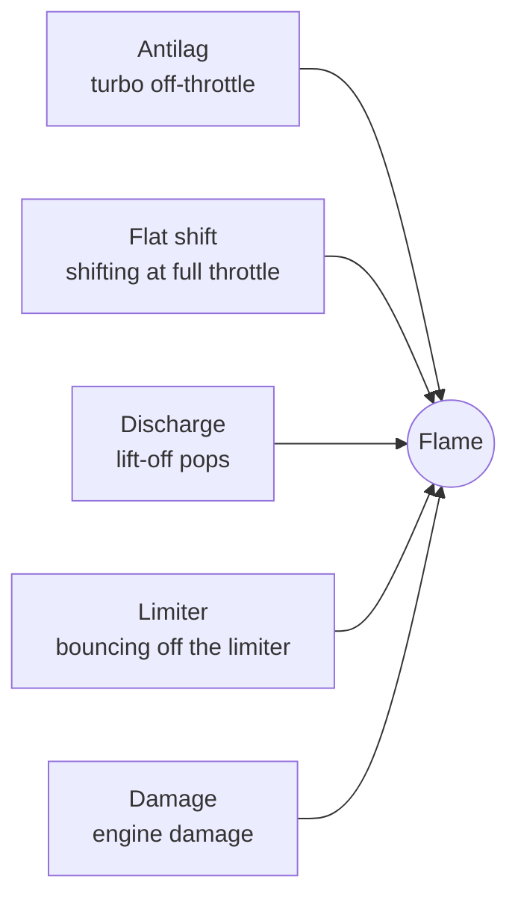

# 11. Exhaust flames

 

CSP adds its own flame logic on top of the game's flames. Where the flames come out is still defined by the car's `data/flames.ini`, like in the original game. When and how strongly they fire is set in `ext_config.ini`.

Source: CSP wiki page [Exhaust flames](https://github.com/ac-custom-shaders-patch/acc-extension-config/wiki/Cars-%E2%80%93-Exhaust-flames). For video walkthroughs see the [flames section](../resources/video-tutorials.md#assetto-corsa-car-work) of the video list.

## The five triggers

All keys live in one section. Each trigger has its own group of keys and can be switched on with `1` or off with `0`.

> [!NOTE]
> The CSP wiki only lists these keys with example values and does not explain them. The descriptions below are based on the key names, so check in game how a change looks.



### Antilag

Pops while the turbo is spooled and you are off the throttle.

```ini
[EXHAUST_FLAMES]
ANTILAG = 0
ANTILAG_DELAY = 0.2
ANTILAG_INTENSITY = 1
ANTILAG_INTERVAL_MIN = 0.05     ; time between pops, random within min..max
ANTILAG_INTERVAL_MAX = 0.1
ANTILAG_TURBO_THRESHOLD = 0.1   ; minimum boost for antilag to fire
```

### Flat shift

A short flame when you shift without lifting.

```ini
FLAT_SHIFT = 1
FLAT_SHIFT_COOLDOWN = 0.23
FLAT_SHIFT_DURATION = 0.05
FLAT_SHIFT_GAS_THRESHOLD = 0.3
FLAT_SHIFT_INTENSITY = 0.1
FLAT_SHIFT_PROBABILITY = 1
FLAT_SHIFT_RPM_THRESHOLD = 4000
```

### Discharge

The classic pop when you lift off at high RPM with a warm engine.

```ini
DISCHARGE = 1
DISCHARGE_CHARGE_TIME = 2
DISCHARGE_DELAY = 1
DISCHARGE_DURATION = 1
DISCHARGE_INTENSITY = 0.205
DISCHARGE_PROBABILITY = 0.735
DISCHARGE_RPM_THRESHOLD_MIN = 4000
DISCHARGE_RPM_THRESHOLD_MAX = 5000
DISCHARGE_WATER_TEMPERATURE_THRESHOLD = 80   ; only with a warm engine
```

### Limiter

Flames while the engine sits on the rev limiter.

```ini
LIMITER = 0
LIMITER_DELAY = 0.3
LIMITER_INTENSITY = 1
LIMITER_RPM_THRESHOLD = 0
```

### Damage

```ini
DAMAGE = 1
DAMAGE_DURATION = 0.05
DAMAGE_INTENSITY = 1
DAMAGE_PROBABILITY = 1
```

## Tuning tips

> [!TIP]
> Change one trigger at a time. Switch the others off with `0`, find values you like, then switch the next one on.

- `*_PROBABILITY` (0 to 1) is the chance that a flame fires when the conditions are met. Lower values look more natural than a flame on every shift.
- `*_INTENSITY` scales the size and brightness.
- A road car usually only wants `DISCHARGE` and maybe `FLAT_SHIFT`. `ANTILAG` and `LIMITER` suit race and drift builds.

---

[← 10. Switches and animations](10-switches-and-animations.md) · [Index](../README.md) · [12. Advanced configs with INIpp →](12-inipp.md)
